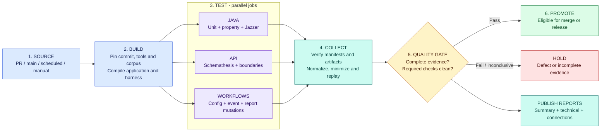
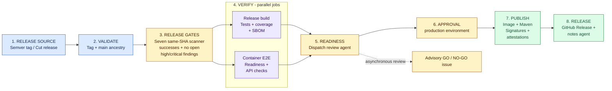
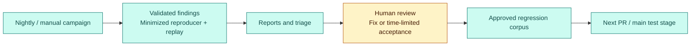

# Fuzzing as a CI/CD pipeline

## Visual overview

[Open the interactive pipeline explorer](fuzzing-pipeline-explorer.html).
Each of the 23 graph cards opens a side panel. The panel lists the tools,
inputs, work, results, limits, and source files for that card. Product logos
open a tool-use map. Status labels separate current steps from planned steps.
The page does not run jobs or approve releases.

Open the HTML file in a browser. GitHub's source viewer does not run its
controls. No build or external service is needed. Keep the local CSS,
JavaScript, SVG, logo, and report files with it.

### Explorer controls

- **Language:** use the English–French switch. It also works inside a side
  panel. The selected area and panel stay open. Text can wrap differently.
  Add `?lang=fr` before a link's `#` to share a French view. The interface and
  both graph views use short, direct English or French. Product names,
  versions, source identifiers, and measured results keep their meaning.
  Source files and historical reports keep their original language.
- **Stage list:** select **List view** for readable stage buttons in pipeline
  order. Each button opens the same details as its graph card. The list is the
  default on small screens and in Windows forced-color mode.
- **Display settings:** choose a light or dark theme, high contrast, readable
  text, or reduced motion. System settings apply by default. Text status labels
  do not depend on color. Settings are stored in this browser when storage is
  available. A visible message reports a storage error.
- **Keyboard:** use Tab to move between controls. Use the arrow keys, Home, and
  End in the area tabs. Press Escape to close a panel and return to its opener.
  A skip link goes to the main content. The panel keeps keyboard focus inside
  it while it is open.
- **Offline and print:** no runtime request goes to an external service. Print
  includes every static area. With JavaScript off, all static areas remain
  readable; side panels and language controls need JavaScript.

The design uses principles from the Engagement Composer work: consistent
spacing, restrained surfaces, semantic color roles, explicit preferences,
system accessibility settings, visible focus, and a text alternative to the
graph. Its visual hierarchy separates content surfaces from control boundaries,
uses restrained elevation, and keeps secondary resources apart from the main
reading path. Controls retain 44-pixel targets; wrapping navigation and panels
adapt to long French labels and enlarged text. Decorative effects become flat
in high-contrast and forced-color modes. This static guide does not copy the
app's backend or native UI.
The language follows simplified technical writing principles. It does not
claim formal language certification or complete WCAG conformance.
The [French writing and terminology standard](french-technical-style.md)
defines the approved vocabulary and review rules. The explorer's Technical
terms section explains the testing and GitHub concepts in both languages.

Open the image for the full-size SVG. Icons identify stages and artifacts;
text badges distinguish proposed architecture from existing release flow.
Pass/hold labels illustrate possible outcomes, not live run results. The
stage tables below provide the text equivalent.

**Presentation option A: stage-based pipeline.** Read left to right, with parallel
test jobs grouped into a stage and explicit promotion gates.

**Presentation option B: detailed connection maps.** The original
[architecture](fuzzing-system-design.md#1-architecture),
[application map](reports/fuzzing-summary-2026-11-10.md#application-connection-map),
and [workflow maps](reports/fuzzing-evidence-2026-11-10.md#3-existing-workflow-connections)
remain available unchanged.

This is a different presentation of the same design, not new infrastructure.
The proposed fuzzing pipeline and the existing release pipeline are shown
separately so future capabilities are not mistaken for deployed ones.

## 1. Proposed continuous integration pipeline

**Source -> Build -> Test in parallel -> Validate evidence -> Gate -> Promote**

Colors distinguish stage roles; labels and gate outcomes carry the meaning
without relying on color. Arrows here describe intended stage dependencies, not
the current cross-workflow scheduling. New gate requirements become blocking
only after the [observation and rollout criteria](fuzzing-system-design.md#8-implementation-sequence-and-acceptance)
are met.

### Stage contract

| Stage | What runs | Evidence handed to the next stage |
|---|---|---|
| 1. Source | Select tested SHA, event, trust tier, campaign budget | Immutable campaign identity |
| 2. Build | Compile Java; prepare local HTTP app and isolated workflow harness | Tool versions, application digest, reviewed corpus digest |
| 3. Test | Java, API, and workflow lanes run independently | JUnit, actual case/execution counts, engine logs, candidate inputs |
| 4. Collect | Validate producer identity/completeness; normalize and replay candidates | Manifest, evidence-health state, defect signatures, replay results |
| 5. Quality gate | Apply deterministic correctness and evidence policies | Pass, fail, or inconclusive with explicit reasons |
| 6. Promote | Mark the change eligible for its next approved step | Same-SHA decision; never automatic production approval |
| Reports | Render every terminal result, including failure or missing evidence | Linked summary, technical report, and detailed graph |

Collection still runs after failed lane jobs. Missing required output is
inconclusive, not a clean campaign. Replay failures stay visible; reporting does
not require a successful gate. Existing static/security scanning, lint, coverage,
and PIT checks remain in place alongside the new fuzzing lanes.

### One pipeline, different campaign profiles

| Trigger | Java/API profile | Workflow profile | Promotion |
|---|---|---|---|
| Pull request | Reviewed regression corpus, property replay, HTTP boundaries | Golden fixtures + bounded mutations | PR eligibility after rollout; no trusted corpus writes |
| Main push | Same-commit regression and contract checks | Full routing/gate controls | Evidence eligible for release checks |
| Nightly | Coverage-guided Java and expanded HTTP campaigns | Deeper seeded mutations | Reviewed regression candidates; no release |
| Manual | Explicit, bounded target and duration selection | Operator-selected scope | Report/replay only unless separately approved |

Exact budgets and resource limits remain in the
[system design](fuzzing-system-design.md#4-scheduling-and-resource-envelope).

## 2. Existing continuous delivery pipeline

This is the repository's current release-stage ordering, not a claim that the
proposed fuzzing gate is deployed. It publishes artifacts; there is no
application deployment stage defined here.

The seven required workflows are CI, SAST, SCA, Secrets and IaC, Container, DAST,
and Fuzzing. Security Gate's completion coordination is separate from Release's
success checks. Scorecard and Workflow lint are not in that seven-workflow list.

The readiness issue is advisory and asynchronous, not a machine-enforced GO
check. Required reviewers depend on external environment configuration, which
the baseline assessment did not inspect. E2E and publication build images
separately; the diagram does not imply matching image digests.

Source: [Release](../.github/workflows/release.yml),
[Cut release](../.github/workflows/cut-release.yml), and
[E2E](../.github/workflows/e2e.yml). The
[original connection ledger](reports/fuzzing-evidence-2026-11-10.md#connection-ledger-and-exact-source-owners)
retains the individual workflow, artifact, agent, and notification connections.

## 3. Proposed continuous feedback loop

Keep the feedback loop below the delivery pipeline rather than weaving it
through every stage. Findings do not automatically become production changes.

Only approved reproducer promotion feeds the corpus; accepting a finding does
not promote its input automatically. Agents may summarize validated evidence,
but cannot waive gates, approve releases, or write trusted corpus state.

## 4. Reports organized by pipeline stage

Use the [executive report](reports/fuzzing-summary-2026-11-10.md) for measured
status and the [technical report](reports/fuzzing-evidence-2026-11-10.md) for
artifact provenance. This view changes navigation, not those results.

| Reader's question | Pipeline stage | Detailed evidence |
|---|---|---|
| What revision was tested? | Source | Tested SHA, run, attempt, event |
| Did it build and test? | Build / Test | JUnit, coverage, PIT, target results |
| Did fuzzing actually execute? | Test / Collect | Effective mode, execution count, corpus state |
| Can we trust the verdict? | Collect / Gate | Completeness, parser status, policy, suppressions |
| Can this release proceed? | Release gates / Approval | Same-SHA scanner results and environment decision |
| What happens to a failure? | Reports / Feedback | Reproducer, issue, owner, reviewed regression |

Focused panels: [Beyond pass/fail: what agents add](visuals/agentic-vs-legacy.svg) and [Reasoning agents with hard limits](visuals/agentic-run-guardrails.svg).
