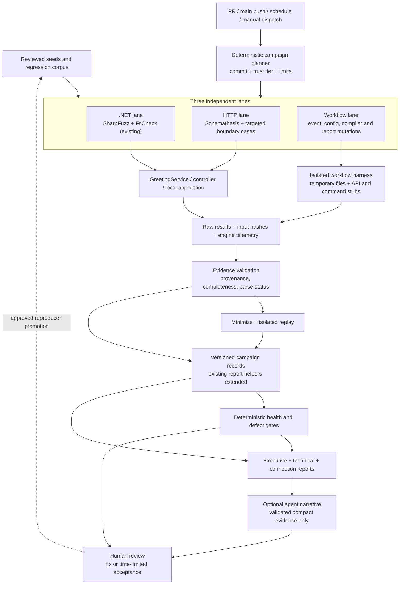
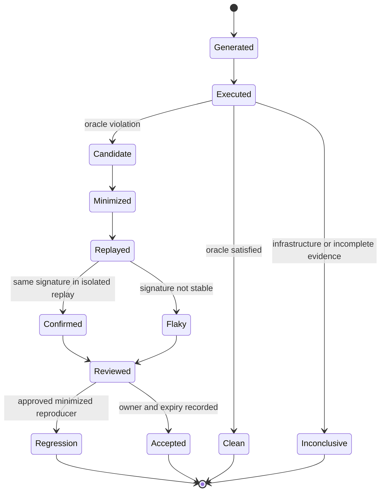

# Fuzzing system design

Status: **proposed, not deployed**. Baseline: commit
`df252e45946c2e86d15783d460e8ed7cacf4fcdf`, observed 2026-11-10 UTC.

**Choose a view:** [Traditional CI/CD pipeline](fuzzing-pipeline-view.md) or
the original detailed architecture and lifecycle diagrams below.

## Outcome and scope

Continuously exercise both the .NET application and the automation that builds,
tests, interprets, and releases it. Every result must connect an input to a
target, oracle, execution, artifact, decision, and follow-up.

This design extends existing SharpFuzz, FsCheck, Schemathesis, actionlint, zizmor,
Stryker.NET, and Python report helpers rather than replacing them. It does not execute
mutated workflows against production, publish packages, or make agents the
authority for pass/fail decisions.

Read the [executive report](reports/fuzzing-summary-2026-11-10.md) and
[technical evidence report](reports/fuzzing-evidence-2026-11-10.md) for measured
results. Budgets, schemas, campaigns, and acceptance criteria below are proposed.

## 1. Architecture

Solid arrows are proposed execution/data connections; the promotion loop needs
human review. Components marked existing are reuse points, not proof that their
proposed integration exists.

### Three independent lanes

| Lane | Real target | Generation | Oracle | Output |
|---|---|---|---|---|
| .NET | `sanitize`, `greet`, `shout` | Coverage-guided bytes, direct UTF-16 strings, FsCheck properties | Independent contract properties, exceptions, bounded work | xUnit, native engine statistics, minimized inputs |
| HTTP | Request decoding, validation, JSON, error mapping, published OpenAPI | Schema-derived and explicit boundary requests | Status/schema consistency, response semantics, no unexpected 5xx | JUnit plus sanitized request/response replay |
| Workflow | YAML/frontmatter, event routing, shell adapters, scanner ingestion, gates, dedupe, rendering | Structured configuration mutations, event sequences, corrupted reports | Expected decisions, parser robustness, command trace, known-mutant detection | Case-level results, graph, fixture, replay manifest |

Coverage in one lane is not coverage in another. ZAP remains complementary DAST,
not a substitute for application or workflow fuzzing. PIT measures test
effectiveness, not random-input throughput.

## 2. .NET and HTTP target contracts

The current [service](../src/)
processes .NET `char` values. Its 50-character limit is a UTF-16 code-unit bound,
not a byte, Unicode-code-point, or grapheme bound.

| Target | Required properties | Boundary corpus |
|---|---|---|
| `sanitize` | Nonblank; at most 50 code units; only letters/digits/space/`-_.`; stable under repeated sanitization | Null, empty, whitespace, only rejected characters, 49/50/51 retained units, long rejected prefix, mixed accepted/rejected runs |
| `greet` | Exactly `Hello, ` + sanitized name + `!`; deterministic; null/empty fallback is `World`; at most 58 code units | Same corpus, UTF-8 decoding replacements, CJK, combining marks, emoji, isolated surrogates through a direct-string target |
| `shout` | Root-locale uppercase of `greet`; deterministic; no exception | Locale-sensitive letters and uppercase expansions; do not incorrectly apply the 58-unit greeting limit after uppercase expansion |
| Valid HTTP requests | Optional `name`; decoded lengths up to 200 accepted by application validation; JSON `message` matches service contract | Missing/empty name, 49/50/51 and 199/200 decoded units, percent-encoded characters, non-ASCII |
| Invalid HTTP requests | 201 decoded units rejected with documented 400 problem response; no stack trace or server implementation details | 201 units, invalid escapes, duplicate parameters, malformed encodings, unsupported methods |
| OpenAPI | Actual valid and validation-error responses match the published contract | Validate both 200 and intended 400 responses; separate framework/transport rejection from application validation |

For malformed transport inputs, assert documented allowed outcome classes rather
than insisting on exactly 400. Determine and record duplicate-parameter binding
behavior before asserting it. JSON escaping, not character deletion alone,
governs response encoding.

Extend the existing
[fuzz target](../src/)
with bounds and semantic oracles. Keep FsCheck's generated-case counts and replay
seeds distinct from xUnit test-method counts. Do not copy the sanitization loop
into the oracle: use output invariants, fixed boundary examples, and metamorphic
relations. A direct-string target is needed because UTF-8 byte decoding cannot
represent every .NET string, including isolated surrogates.

Use the existing test corpus convention supported by the pinned Jazzer version.
Explicitly configure and verify the generated-corpus location before caching it;
do not assume `.cifuzz-corpus` is automatically populated. Record both requested
and effective duration, target selection, regression/fuzz mode, and engine
execution count. A JUnit invocation alone does not establish a fuzz campaign.

## 3. Workflow fuzzing: what is actually exercised

Do not fuzz GitHub's hosted scheduler or invent a general Actions-expression
interpreter. Exercise repository-owned decision logic using fixtures; use
actionlint and compilation for syntax; reserve genuine hosted behavior for
approved integration checks.

| Campaign | Mutation inputs | Required checks |
|---|---|---|
| W1: configuration and compilation | YAML scalar types, missing/extra keys, `needs` graphs, matrices, frontmatter, imports, action refs | Bounded parse/compile; invalid inputs rejected; cycles/unknown jobs detected; pinned compiler produces expected structure |
| W2: event and trust routing | PR vs push, fork vs same-repo, main vs tag, completion vs cancellation, synthetic event fields | Correct lane/mode; no trusted publication from fork data; allowed branch/event filters; inputs validated before shell use |
| W3: orchestration sequences | Missing scanners, out-of-order completions, duplicate events, multiple attempts, stale success, canceled jobs, paginated API responses | Expected scanners all accounted for; commit/event/attempt alignment; no premature success; idempotent final aggregation |
| W4: report ingestion | SARIF/xUnit/ZAP/Roslyn analyzer/dotnet format/JSON mutations, absent files, malformed XML/JSON, excessive nesting/size, duplicate records | No hangs; structured parse errors; missing evidence is inconclusive; stable counts and classification |
| W5: suppression and dedupe | Expired entries, changed paths, repeated crashes, open/closed issues, signature changes, issue-list pagination | Expiry respected; distinct failures not merged; repeats linked; closed findings can recur under an explicit recurrence policy |
| W6: rendering and replay metadata | Quotes, newlines, Markdown/HTML metacharacters, annotation control text, long strings, local paths | Escaped output; no interpreted instructions; bounded excerpts; portable replay; no secret/raw-payload publication |
| W7: release decisions | Semver inputs, prior tags, missing/failed checks, mismatched artifact SHA, missing approval | Reject invalid release candidates; select correct evidence; never invoke real tagging, publishing, signing, or production approvals |

Use handwritten golden cases for important decisions and generated mutations for
exploration. An invalid fixture rejected by a validator is an **expected
rejection**, not a defect. Supported-valid fixtures unexpectedly rejected,
crashes, timeouts, unexpected acceptance, and decision divergence are defects.

### Harness boundary and realism

1. Extract only repository-owned shell decision blocks into small testable
   adapters when implementation begins; production workflows must call the same
   adapters so tests do not merely verify a disconnected model.
2. Provide deterministic `gh`, Git, network, clock, and filesystem responses.
   Record the intended command arguments and effects. Interpolation-sensitive
   synthetic values use harmless sentinels, never executable payloads.
3. Keep mutated workflow files and generated lock files in temporary directories.
   Do not run mutated `run` steps, actions, compiler install hooks, or arbitrary
   commands. Compilation has no inference credentials or write tokens.
4. Compare assertions against real repository adapters and pinned validators.
   Mark unsupported hosted semantics **not tested**, rather than modeling them
   as passing.
5. To verify hosted expression/filter/permission behavior later, require explicit
   approval for a disposable repository with synthetic data, capped runs, no
   production secrets, and no publish path. This is not part of local fuzzing.

Generated maintenance and `*.lock.yml` files are inventory/analysis targets, not
hand-edited production files. Mutate authoring inputs and compile in scratch
space; compare normalized semantic structure, excluding documented volatile
fields, instead of assuming byte-identical compiler output.

### Known-mutant controls

Seed controls must include: ignore a missing scanner; use an older successful
attempt; accept a different SHA; swallow malformed evidence; disable the
201-unit rejection; remove the service length cap; and merge two different
failure signatures. Each control must be detected by the appropriate oracle.
The control suite must also accept known-good and intentionally rejected cases.
Report workflow mutant detection separately from Stryker.NET.

## 4. Scheduling and resource envelope

These are initial design limits, not measured capacity. Run only on dedicated,
ephemeral CI workers. Local use must stay within explicitly selected temporary
directories and loopback ports; this workstation is shared.

| Tier | .NET | HTTP | Workflow | Operational limit |
|---|---|---|---|---|
| PR | Reviewed regressions and fixed FsCheck replay seeds; no corpus promotion | Boundary replay and up to 200 examples per operation | Golden cases plus 200 seeded mutations | 12-minute wall cap; 3 concurrent lane jobs |
| Main push | PR suite plus new regression inputs | Same-commit app/contract replay | Full routing and gate controls | Same caps; trusted evidence publication only |
| Nightly | 3 targets, 5 minutes effective fuzz time each, sequential inside lane | 5 minutes, at most 1,000 examples per operation | Up to 5,000 mutations or 5 minutes, whichever first | 25-minute lane cap, at most 3 lane jobs |
| Manual deep | 1-15 minutes per target, hard maximum 3 targets | At most 10 minutes | At most 10,000 mutations or 10 minutes | 60-minute lane cap; operator-selected scope |

Validate duration as a bounded value, not arbitrary shell syntax. Reserve time
for build/startup, minimization, and upload; a timed-out job is incomplete even
when its last progress message was healthy. Do not multiply manual duration
through an unbounded matrix. Record runner-minutes separately from wall time.

Initial per-worker caps: 2 CPUs, 4 GiB memory, 1 GiB campaign disk; .NET fuzz input
4 KiB; HTTP query 8 KiB; normalizer fixture 1 MiB; report nesting depth 64; 1,000
files and 100 MiB total expanded artifact content. Oversize-limit tests assert
explicit rejection. Limits are harness envelopes, not new production behavior.
Use process/container resource enforcement where supported; report unavailable
enforcement rather than claiming isolation.

Per-case process watchdogs apply to parser/workflow cases. Enforce an HTTP
request timeout and restart an unhealthy application between campaigns. Stop
only the specific processes/containers created by that campaign.

## 5. Evidence contract and persistence

Introduce an additive campaign manifest alongside existing `findings-*` artifacts;
do not silently change the current findings schema or its consumers.

| Record | Required data |
|---|---|
| Identity | Schema version, repository, tested commit, workflow path, run ID and attempt, job/target ID, event, PR head and tested merge SHA when applicable |
| Provenance | Harness/config revision, exact engine/compiler versions, action SHAs, tool artifact digests, application jar/image digest for HTTP |
| Campaign | Lane, target, requested/effective mode and budget, UTC timestamps, seed, limits, corpus input/output digest |
| Execution | Generated/accepted/rejected cases, engine executions, FsCheck checks, request count, completion reason, exit status, resource usage |
| Evidence health | Expected/received artifact list, parse status per file, schema validation, producer conclusion, missing/expired/corrupt reasons |
| Defect | Stable signature, category, severity rationale where applicable, location, original/minimized input digest, replay outcomes, first/last seen |
| Decision | Health state, defect state, gate-policy revision, blocking reasons, suppressions with owner/reason/expiry |
| Connections | Typed source/target edges with evidence IDs; run/artifact/source links; observed vs proposed status |

Use SHA-512 for new corpus, manifest, and replay-bundle integrity hashes.
Retain existing SHA-256 finding fingerprints for compatibility; they are
identifiers, not dependency-integrity upgrades.

### Data lifecycle

Retain the original failing input even if minimization fails. Replay a candidate
three times in fresh isolation; record all outcomes, not just the successful
reproduction. A deterministic failure can block immediately while replay is
pending; intermittent failures remain visible and are never rewritten as clean.
Fingerprint by target, violated oracle, and normalized failure/root-cause
signature, not input bytes alone. Keep each occurrence and its input hash.

Trusted main/nightly runs may propose corpus changes; PRs consume the reviewed
corpus but cannot promote or overwrite trusted state. Partition caches by trust
tier, target, engine version, and harness/corpus compatibility. Cache is an
optimization, not durable evidence or a trusted baseline.

Store per-run raw artifacts/replay bundles for 30 days, subject to repository
policy. Store compact, redacted trend manifests for 180 days in an explicitly
configured durable repository-owned store; if unavailable, show retention
limits and do not promise long-term trends. Commit only reviewed minimal
regressions. Publish no user data, secrets, or unrestricted raw logs.

## 6. Health, defect, and release gates

Maintain two separate dimensions:

| Dimension | States | Meaning |
|---|---|---|
| Evidence health | Complete / Inconclusive / Skipped | Did every required target execute with valid evidence for this exact identity? |
| Defect outcome | Clean / Failed / Unassessed | Were required oracles satisfied? Unassessed is not clean. |

Overall pass requires **Complete + Clean**. Missing JUnit, zero selected tests,
parse errors, wrong SHA, failed tool startup, missing required jobs, or expired
artifacts cannot produce a pass. Intentional skips need a recorded reason and
must not satisfy a required release check.

Select results by repository + workflow path + tested SHA + event + explicit
attempt policy. Use the latest completed relevant run/attempt, never "any success
for this SHA"; an active newer attempt makes the decision pending. Paginate API
responses, enforce a deadline, and show expected vs received producers. Artifact
names alone do not authenticate provenance; verify GitHub producer metadata,
allowlisted workflow identity, SHA, event, attempt, and manifest consistency.

Initially report new workflow campaigns as advisory while validating the
harness. After rollout acceptance, block on required contract regressions,
confirmed harness decision defects, and incomplete required evidence. Preserve
the current high/critical security policy unless separately approved; a contract
failure need not be mislabeled as a high-severity security vulnerability to block
a correctness gate. Suppressions affect explicit defects, never missing evidence.

Security Gate currently coordinates completion; Release separately checks
scanner success. Keep those roles distinct. Add future fuzz requirements to
producer lists, trusted aggregation, Release, readiness, daily reporting, and
failure analysis together; a new workflow name alone is not integration.

## 7. High-fidelity reporting

Generate reports deterministically from the validated manifest and graph.
Optional agents explain results but cannot alter counts, decide evidence health,
waive gates, execute reproducers, or promote corpus inputs. Scanner strings remain
untrusted data; render escaped, bounded excerpts and approved links only.

| Report | Audience and contents |
|---|---|
| Per-run executive | Tested SHA/time, health vs defect verdict, new/known/fixed/intermittent counts, top actions, scope exclusions |
| Technical | Target/oracle matrix, actual budgets and executions, coverage by target, replay details, tool exits, parser errors, limits, source/run/artifact links |
| Connection map | Event-to-job dependencies, target-to-code calls, artifact producer/consumer edges, normalization, gates, agent safe outputs, release dependencies |
| Daily/weekly trend | Comparable campaigns only; unique signatures, recurrence, time to reproduce/fix, corpus growth, branch coverage, throughput and resource cost |

Every reported metric needs numerator/denominator, units, scope, timestamp, and
evidence ID. Show unknown as **not measured**, not zero. Never equate one JUnit
method with one generated input; never label a regression run "fuzzing"; never
sum overlapping scanner records as unique vulnerabilities. Distinguish expected
invalid fixtures, discovered failures, infrastructure errors, and suppressions.

Generate diagrams from typed edges, not language-model guesses. Required edge
types are `triggers`, `needs`, `calls`, `produces`, `consumes`, `gates`,
`notifies`, `compiles`, and `promotes`. Each edge carries an observed/proposed
flag and source evidence. Avoid mixing a future architecture into a current-state
diagram without an explicit legend.

## 8. Implementation sequence and acceptance

No phase below was implemented by this documentation change.

1. **Evidence first:** add manifests and strict completeness checks around
   existing runners/normalizers. Fix mode labels and verify effective Jazzer
   duration/corpus behavior. Preserve schema-1 consumers.
2. **Application oracles:** add the .NET/string and HTTP boundaries, retain the
   existing 400 behavior, and document intended responses in OpenAPI. Promote
   the observed ST103 case only after reproducing it on the implementation SHA.
3. **Workflow harness:** share decision adapters with production workflows; add
   W1-W7 fixtures, generated cases, control mutants, and isolated replay.
4. **Report integration:** emit typed graph and manifest-derived reports; extend
   existing trusted agent inputs without handing agents raw executable content.
5. **Observe, then gate:** collect seven consecutive complete nightly campaigns
   and at least ten representative PR campaigns; review runtime and false
   positives before enabling new required checks.

Release acceptance requires all of the following:

- Every declared target has at least one valid control and one failure control.
- Every named known-mutant control is detected; report the count and denominator.
- Golden cases cover missing producer, wrong SHA, malformed evidence, newer
  failed attempt, duplicate event, timeout, and all-clean execution.
- Zero-case selection, suppressed parse errors, and cache misses cannot masquerade
  as completed fuzz campaigns.
- Every confirmed defect has a portable, hashed reproducer and recorded replay
  outcomes; failures to minimize remain explicit.
- A cold-cache run and a restored-corpus run both prove the effective engine mode,
  duration, and discovered-corpus path.
- Reports and all diagram edges resolve to manifests and accessible evidence;
  inaccessible/expired evidence is visibly marked.
- No production writes occur during local/harness campaigns; shared-host cleanup
  touches only campaign-owned resources.
- Existing unit/integration behavior, scanner policies, lint checks, and compiled
  workflow reproducibility remain intact.
