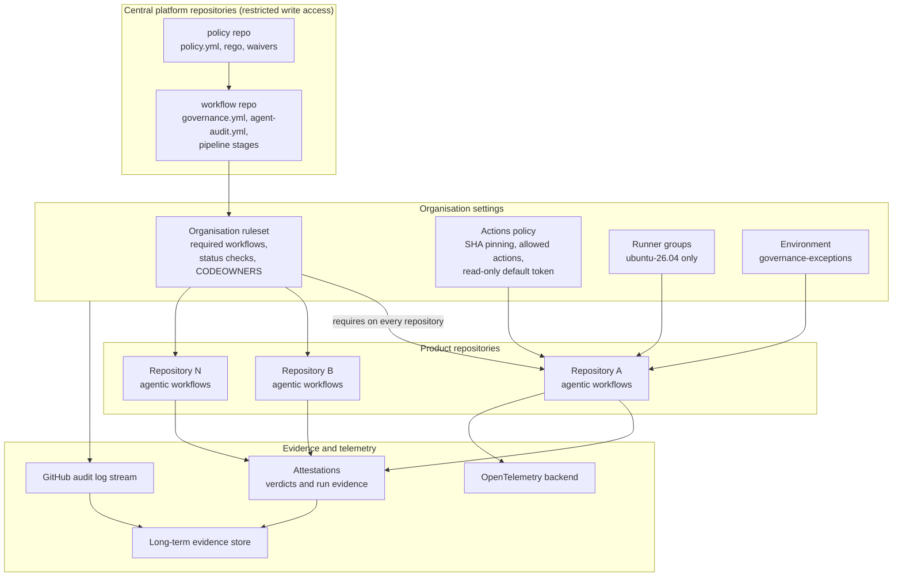

# Enterprise scale

This repository is a proof of concept. It shows that policy, audit and inspection can run as
pipeline stages. A proof of concept that works for one repository is not yet an enterprise
platform. This page describes the production topology that carries the same controls to
hundreds of repositories, and the stages to get there.

## Target topology

## Controls and where they live

| Concern | In this repository | At enterprise scale |
|---|---|---|
| Policy | `policy/` next to the code | A central policy repository, called through `policy-repository` and pinned by commit SHA. Product teams cannot edit it. |
| Enforcement | `Governance` stage in `pipeline.yml` and its gate | An organisation ruleset that requires the governance workflow (a required workflow) and the pipeline gate status check on every protected branch, so a repository cannot opt out by editing its own `pipeline.yml`. |
| Change control | CODEOWNERS on `/policy/` | CODEOWNERS plus a ruleset that requires code owner review. Policy owners are a separate team from workflow authors. Use rulesets, not branch protection alone, to target repositories by custom property. |
| Supply chain | Rule `action-pin` plus Dependabot | The organisation Actions policy requires actions to be pinned to a full commit SHA and restricts which actions are allowed. The policy rule then becomes a second line of defence. |
| Token | `permissions: {}` per workflow | Organisation default of read-only `GITHUB_TOKEN`; fork pull requests cannot reach secrets. |
| Runners | `ubuntu-26.04` pinned in every workflow | Runner groups restrict which repositories may use which runners. Use larger or self-hosted runners in a group only when needed, with network egress controls, and keep the pin in policy. |
| Secrets | Repository secrets | Organisation secrets scoped to selected repositories, environment secrets for anything an approval protects, and OIDC federation to cloud providers instead of long-lived keys. |
| Models and providers | Engine and model allowlists in `policy.yml`; resolved model checked after each run | Enterprise and organisation Copilot policies decide which models and features are enabled. Policy narrows that further for agents, and the audit trail proves which model actually ran. |
| Cost | `max-ai-credits`, `max-daily-ai-credits`, `timeout-minutes` per workflow | The same ceilings as policy, plus per-team ceilings in the central policy and spend alerts on the usage reported by `gh aw logs` and the evidence records. |
| Audit | Signed evidence per run, 90 day artifacts | Evidence copied to a long-term store; the GitHub audit log streamed to a SIEM; attestations verified in release gates. |
| Exceptions | `waivers.yml` and the `governance-exceptions` environment | Waivers kept in the central policy repository. The environment lives in the repository that runs the workflow, with required reviewers from the risk team and self-review prevented. |

## Rollout stages

| Stage | Scope | What changes | Exit criteria |
|---|---|---|---|
| Proof of concept | One repository | Policy, audit and inspection run as stages in the repository itself. | Every agentic run has signed evidence; the policy tests pass; reviewers can read a report without opening the lock file. |
| Pilot | A handful of volunteer repositories | Move `policy/` and the workflows to central repositories. Product repositories call the reusable workflows pinned to a SHA. Run the policy in `mode: audit` first, then switch to `enforce`. | No unexplained violations for two weeks; the waiver process has been used and reviewed; cost data matches expectations. |
| Enterprise | All repositories with agentic workflows | Organisation rulesets require the governance workflow and the gate. Actions policy, runner groups, secrets scoping and audit log streaming are in place. Evidence is exported to the long-term store. | Coverage is measured, not assumed: a report lists repositories without the required workflow, and it is empty. |

## Operating at scale

- **Version the policy.** Release the central policy with tags. Roll a new rule out in
  `mode: audit`, read the findings, then enforce. Product repositories pin a policy commit SHA,
  and Dependabot proposes updates.
- **Measure coverage.** Query evidence records, not intentions: count agentic runs with a
  signed record against runs without one.
- **Plan capacity.** Each agentic run triggers one short audit job. For high volume, batch the
  evidence by listing the day's runs with `gh run list` and rebuilding records in a scheduled
  job rather than per run.
- **Separate duties.** The people who approve exceptions are not the people who request them.
  Review the list of active waivers on a schedule; expired ones already fail the gate.
- **Keep the evaluator boring.** The evaluator is deterministic and pinned. Changes to
  `govern.py`, OPA or the rules go through the same review as policy.

## What this repository does not solve

A single repository cannot enforce its own governance against a determined owner: someone who
can edit the workflow and the policy can remove both. The enterprise controls above, an
organisation ruleset and a central policy repository, are what close that gap. Treat the
repository-local version as the reference implementation and the training ground, not as the
final control.
