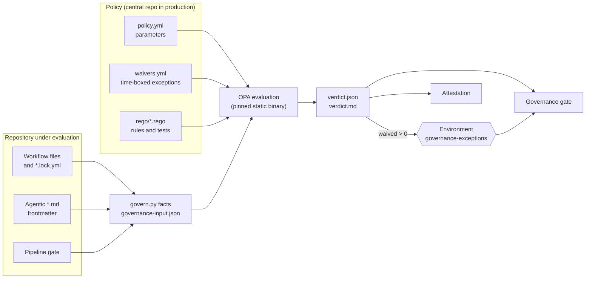

# Policy as code

Governance in this repository is an executable pipeline stage, not a document. The
[Governance workflow](../../.github/workflows/governance.yml) is deterministic: no model is
involved, the same inputs always give the same verdict, and a violation fails the
[pipeline gate](../../.github/workflows/pipeline.yml).

## How it works



1. `scripts/governance/govern.py facts` reads every workflow, every agentic workflow's
   frontmatter and its compiled lock file, and the pipeline gate. It writes one
   `governance-input.json` that holds the facts, the policy parameters, the waivers and the
   evaluation date. That file is the complete input, so any verdict can be reproduced.
2. OPA evaluates the Rego rules in [policy/rego](../../policy/rego) against it.
3. The workflow publishes `verdict.json` (for machines) and `verdict.md` (the job summary),
   and optionally [attests](audit-trail.md#signed-evidence) the verdict.
4. A violation covered by an active waiver stops being blocking, but the run then pauses in
   the `governance-exceptions` environment until a required reviewer approves it.
5. The `gate` job fails on a blocking violation, an evaluation error, or an exception that
   was not approved.

## What is enforced

All thresholds live in [policy/policy.yml](../../policy/policy.yml). The rule logic lives in
[static.rego](../../policy/rego/static.rego) and covers these areas.

| Area | Rules | Source of truth |
|---|---|---|
| Runners | Every job, plus `safe-outputs.runs-on` and `threat-detection.runs-on`, uses `ubuntu-26.04` | `runner-pin` |
| Supply chain | Actions and images pinned to a commit SHA or digest; owners on an approved list | `action-pin`, `action-owner` |
| Least privilege | Top-level `permissions` declared and not `write-all`; agent and detection jobs hold no write scope except `copilot-requests`; frontmatter requests no extra write scope; `pull_request_target` forbidden | `permissions-declared`, `agent-job-read-only`, `frontmatter-write-permission`, `forbidden-trigger` |
| Agent definition | Engine and model allowlists; network entries from an approved list with no wildcards; no unrestricted bash; threat detection enabled | `engine-allowlist`, `model-allowlist`, `network-allowlist`, `bash-restricted`, `threat-detection-required` |
| Safe outputs | Only approved output types, each capped per run | `safe-output-type`, `safe-output-max` |
| Token budgets | `max-ai-credits`, `max-daily-ai-credits` and `timeout-minutes` set and under the ceiling for that workflow | `budget-missing`, `budget-exceeded` |
| Pipeline gate | `gate` runs with `if: always()` and requires every other stage, including `governance` | `pipeline-gate` |
| Exceptions | Waivers are complete, unexpired and no longer than 90 days | `waiver-invalid`, `waiver-expired`, `waiver-unused` |

Token budgets are enforced twice. Policy checks that a budget is declared and within the
ceiling. gh-aw then enforces it at run time: the compiled lock file carries
`GH_AW_MAX_AI_CREDITS` and `GH_AW_MAX_DAILY_AI_CREDITS`, and a guardrail step refuses to admit
a run once the daily total is exhausted. The [audit trail](audit-trail.md) re-checks actual
consumption after each run.

## Changing policy

Edit [policy/policy.yml](../../policy/policy.yml) to change a value (for example to approve a
new action owner or raise one workflow's budget). Edit the Rego only to add or alter a rule, and
add a case to [static_test.rego](../../policy/rego/static_test.rego). Run the tests locally:

```bash
opa test policy/rego
python scripts/governance/govern.py evaluate --root . --opa ./opa --out-dir out
```

[CODEOWNERS](../../.github/CODEOWNERS) assigns `/policy/` and `/scripts/governance/` to the
policy owners, so a change to the rules needs their review. In production, require review from a
team that is separate from the people who write workflows.

Set `mode: audit` in `policy.yml` (or pass `mode: audit` to the workflow) to report without
blocking while a new rule is rolled out. `enforce` is the default.

## Exceptions and approvals

An exception is a record in [policy/waivers.yml](../../policy/waivers.yml). It names the rule
and the subject, gives a reason, an approver, a ticket and an expiry date no more than 90 days
away.

```yaml
waivers:
  - id: W-2026-001
    rule: budget-exceeded
    subject: security-remediation
    reason: Large refactor batch needs a higher per-run ceiling for one release.
    approved_by: policy-owners
    ticket: https://example.invalid/tickets/1234
    expires: 2026-12-31
```

Two controls apply. The change to `waivers.yml` needs review from the policy owners. Then any
run that relies on the waiver pauses in the `governance-exceptions` environment until one of
its required reviewers approves. Create the environment and its reviewers once:

```bash
gh api -X PUT repos/<owner>/<repo>/environments/governance-exceptions \
  -f 'prevent_self_review=true' \
  -F 'reviewers[][type]=Team' -F 'reviewers[][id]=<team-id>'
```

An environment with no required reviewers does not pause, so configure reviewers before you
rely on this control. Waivers cannot silence the rules that police waivers, and an expired
waiver is itself a blocking violation, so exceptions cannot linger unnoticed.

## Reusing the workflow

`governance.yml` is a reusable workflow. Another repository calls it and points it at a central
policy repository, so policy and evaluator are owned in one place:

```yaml
jobs:
  governance:
    permissions:
      contents: read
      id-token: write
      attestations: write
    uses: <org>/<policy-repo>/.github/workflows/governance.yml@<commit-sha>
    with:
      policy-repository: <org>/<policy-repo>
      policy-ref: <commit-sha>
      attest: true
    secrets:
      POLICY_TOKEN: ${{ secrets.POLICY_TOKEN }}
```

[Enterprise scale](enterprise-scale.md) describes the full topology.
