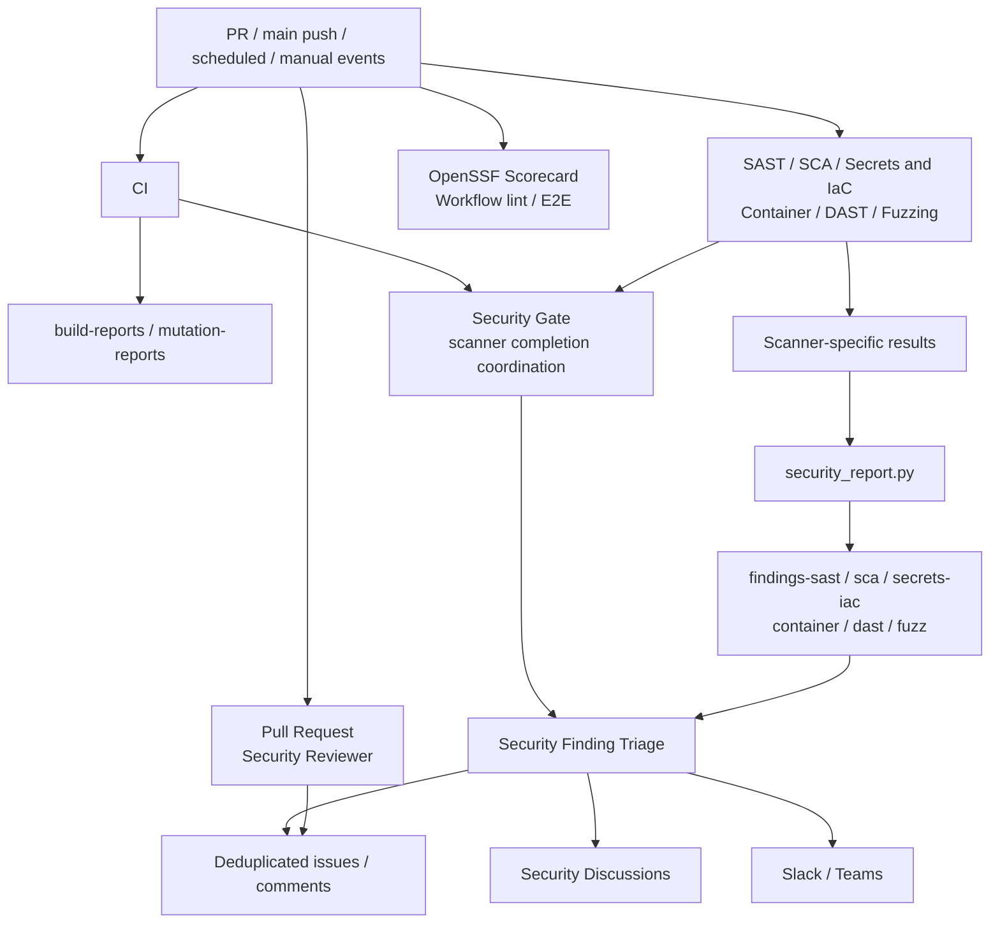
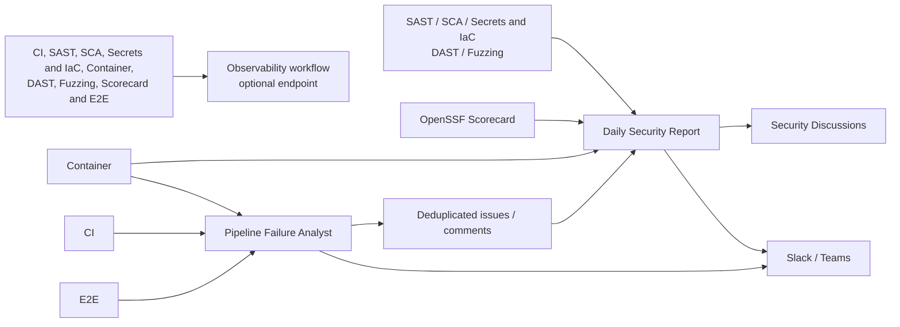
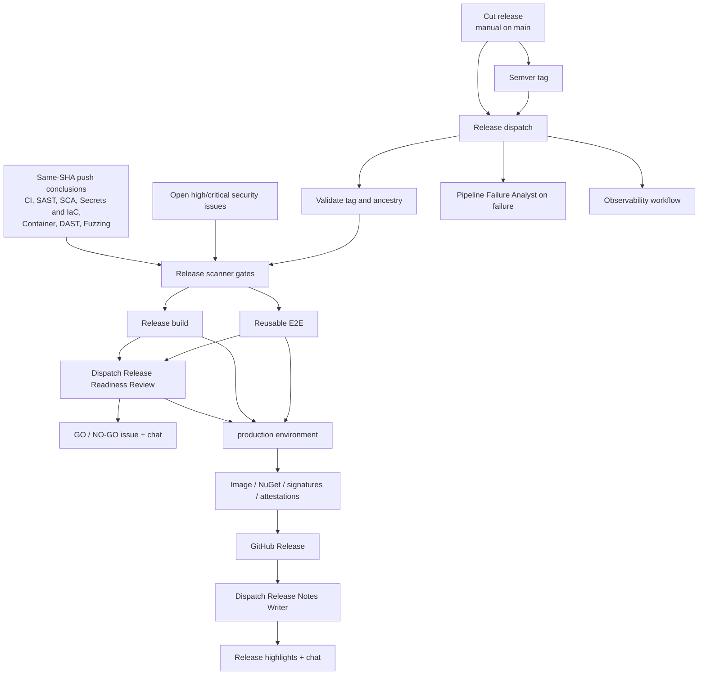
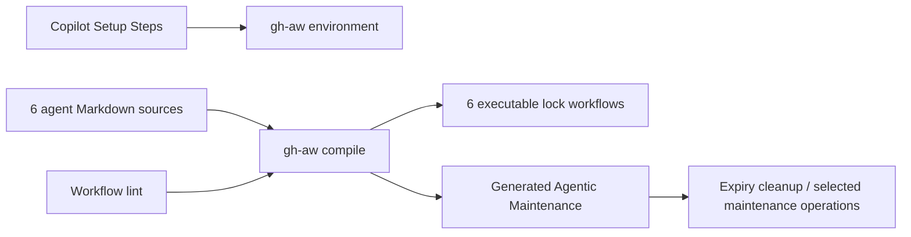
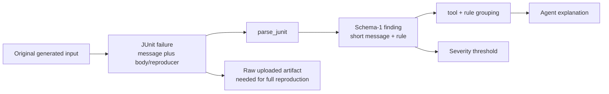

# Fuzzing technical evidence and connection report

**Choose a view:** [Traditional CI/CD pipeline](../fuzzing-pipeline-view.md) or
the original [detailed workflow maps](#3-existing-workflow-connections) below.

## 1. Evidence scope and provenance

Snapshot collected 2026-11-10 UTC against
`df252e45946c2e86d15783d460e8ed7cacf4fcdf`. Sources: clean starting worktree,
workflow/application/test source, read-only GitHub Actions API queries, downloaded
CI/Fuzzing/DAST artifacts, and selected Fuzzing logs. The design deliverable is
[separate](../fuzzing-system-design.md); proposed connections are not represented
as deployed capabilities here.

| ID | Evidence and identity | Used for |
|---|---|---|
| E1 | [Fuzzing run 42732777125](https://github.com/ChristianPresley/agentic-pipelines/actions/runs/42732777125), push, attempt 1, baseline SHA | Dedicated regression result and cache log |
| E2 | [fuzzer artifact 13725202648](https://github.com/ChristianPresley/agentic-pipelines/actions/runs/42732777125/artifacts/13725202648), `fuzz-results` | Test-result XML: one test, 7.893 s |
| E3 | [Findings artifact 13724974274](https://github.com/ChristianPresley/agentic-pipelines/actions/runs/42732777125/artifacts/13724974274), `findings-fuzz` | Schema 1; no findings, no blocking records |
| E4 | [DAST run 42732776744](https://github.com/ChristianPresley/agentic-pipelines/actions/runs/42732776744), push, attempt 1, baseline SHA | API fuzzing and DAST outcome |
| E5 | [Schemathesis artifact 13724734696](https://github.com/ChristianPresley/agentic-pipelines/actions/runs/42732776744/artifacts/13724734696), `schemathesis-results` | ST103 operation-level failure and request |
| E6 | [DAST findings artifact 13726080575](https://github.com/ChristianPresley/agentic-pipelines/actions/runs/42732776744/artifacts/13726080575), `findings-dast` | 10 normalized records and severity distribution |
| E7 | [CI run 42732776469](https://github.com/ChristianPresley/agentic-pipelines/actions/runs/42732776469), push, attempt 1, baseline SHA | Unit/property/integration and quality evidence |
| E8 | [Build artifact 13725138339](https://github.com/ChristianPresley/agentic-pipelines/actions/runs/42732776469/artifacts/13725138339), `build-reports` | xUnit, build summary, aggregate coverlet |
| E9 | [Mutation artifact 13724544989](https://github.com/ChristianPresley/agentic-pipelines/actions/runs/42732776469/artifacts/13724544989), `mutation-reports` | 17 mutation records, all KILLED |
| E10 | [Workflow lint run 42726975185](https://github.com/ChristianPresley/agentic-pipelines/actions/runs/42726975185), push, SHA `71143ba95b743d7c443ec851dfe23035d8f06a3a` | Historical lint success, not baseline-SHA evidence |
| E11 | [Scorecard run 42732776397](https://github.com/ChristianPresley/agentic-pipelines/actions/runs/42732776397), push, baseline SHA | Failure conclusion only; root cause not established |

Artifact availability was verified through the API (`expired=false`) during
collection. Access requires repository authorization and is subject to retention.
This report preserves the measured values; links may expire. Artifact producer
identity was checked against API run metadata and embedded findings SHA where
available. Existing artifacts do not contain the full proposed replay/provenance
manifest.

Remote source links below use the immutable
[baseline tree](https://github.com/ChristianPresley/agentic-pipelines/tree/df252e45946c2e86d15783d460e8ed7cacf4fcdf).
Relative source links navigate the current checkout.

## 2. Measured execution and oracle results

### .NET

| Suite | Tests | Failures / errors / skipped | Suite seconds | Source |
|---|---:|---|---:|---|
| GreetingServiceTest | 6 | 0 / 0 / 0 | 0.045 | E8 |
| GreetingServicePropertyTest | 2 | 0 / 0 / 0 | 0.717 | E8 |
| GreetingServiceFuzzTest (CI regression) | 1 | 0 / 0 / 0 | 9.297 | E8 |
| HelloControllerTest | 3 | 0 / 0 / 0 | 4.627 | E8 |
| HelloApplicationIT | 3 | 0 / 0 / 0 | 6.351 | E8 |
| **CI total** | **15** | **0 / 0 / 0** | **21.037** | E8 |
| GreetingServiceFuzzTest (dedicated workflow) | 1 | 0 / 0 / 0 | 7.893 | E2; not added to CI total |

Suite time is the test-runner-reported duration, not engine fuzzing time or runner cost.
The CI property XML records 1,000 checks per property:

- `greetingNeverNullAndAlwaysWellFormed`: seed `8963026254894808161`.
- `sanitizedNameIsBoundedAndSafe`: seed `305203101436964123`.

These seeds identify the sampled FsCheck run; replay also requires the same FsCheck,
code, and generator configuration.

coverlet E8 records 20 covered / 22 total lines and 16 covered / 18 total branches.
`GreetingService` has 12/12 covered lines and 16/18 covered branches.
`HelloApplication` accounts for the two missed lines. This does not isolate
coverage contributed by fuzzing. E9 records 17 killed out of 17 mutations,
with no surviving/no-coverage records in this sample. The
[mutation profile](../../stryker-config.json) excludes fuzz, property, and `*IT` test classes.
The build summary's `mutation: null` belongs to the separate build job, not proof
that the separate mutation job did not run.

### Effective fuzzer mode and persistence

E1 is a push run. The [workflow shell branch](../../.github/workflows/fuzz.yml)
executes regression on both PR and push. Its job-name expression labels only PRs
as regression, hence E1's misleading `fuzzer (fuzzing)` label.

The E1 log records:

- `EVENT_NAME: push`.
- One selected test, no failures/errors/skips.
- Cache miss for the run key and fallback prefix.
- Cache path validation warning: configured path did not exist; no cache saved.

E2 contains test-result reports only, not a corpus or crash input. The reviewed test
resources contained no corpus files. This is evidence of missing persistence in
the sampled regression run, **not** proof that every scheduled run loses corpus.

The source specifies a 30-second annotation and passes a duration property for
scheduled/manual fuzzing, with a five-minute shell fallback and ten-minute manual
input default. Effective precedence and engine fuzzing duration were not measured.
The last five fetched runs were all successful PR/push runs:

| Run | Event | SHA prefix | Conclusion |
|---|---|---|---|
| 42732777125 | push | df252e45 | success |
| 42732500731 | pull_request | b7ffb82e | success |
| 42726975062 | push | 71143ba9 | success |
| 42726625209 | pull_request | b6231229 | success |
| 42724021236 | push | c6779141 | success |

No conclusion about nightly throughput, new edges, minimization success, or
crash-replay reliability follows from this bounded sample.

### HTTP contract failure

E5 reports one operation testcase (`GET /api/hello`), one failure, zero errors,
zero skips, and 2.016543 s. It does not report the total generated request count.
The configured 200-example cap is not a measured execution count.

The failure is `ST103 Undocumented status code`: received 400, documented 200.
Its request has a long all-zero `name` query value; its response is a 400 problem
object with detail `Invalid request parameter`. This agrees with the
[controller's 200-unit limit](../../src/)
and [generic validation handler](../../src/).
The intended design action is to document and test the validation response,
not weaken validation. The raw reproduction is in E5; it was not rerun here.

E6 classifies Schemathesis failures as medium; the DAST threshold is high.
The Schemathesis shell command also tolerates a nonzero exit so normalization
can apply the severity policy. Thus DAST success and a recorded contract failure
are consistent with the current configuration.

| E6 record class | Count | Interpretation |
|---|---:|---|
| Schemathesis medium | 1 | ST103 contract discrepancy |
| ZAP medium | 1 | Scanner-reported framework health-endpoint information leak; not independently confirmed |
| ZAP low | 2 | Cross-Origin-Resource-Policy and X-Content-Type-Options headers |
| ZAP info | 6 | Client errors, four fetch-metadata header records, cacheability |
| Critical / high / suppressed / blocking | 0 / 0 / 0 / 0 | Current normalized output, not proof of no defects |

The four fetch-metadata records share a group/fingerprint but retain different
messages. Do not count those records as four independent vulnerabilities.

## 3. Existing workflow connections

There are 22 executable definitions under
[workflows](../../.github/workflows): 15 standard YAML workflows, six compiled
agentic lock files, and one generated maintenance workflow. Six Markdown source
files author the six compiled agentic workflows.

Solid edges below are source-declared dependencies/data paths, not proof that
every path completed in this snapshot. The ledger immediately below defines
the grouped connections.

CI and the six scanner workflows feed the gate; only the scanners produce
findings files. The next diagram shows the reporting and monitoring
workflows that read the same events and outputs.

The event node is an event family, not a claim that every connected workflow has
every trigger. Lint/E2E apply path filters; PR review excludes forks; downstream
workflow-run agents have their own conclusion/branch conditions.

The agentic workflow sources and their tooling form a separate chain:

Readiness dispatch is not a machine-enforced GO decision; publication waits for
the configured `production` environment, whose external reviewer configuration
was not inspected. The readiness agent reports asynchronously. Image builds
occur in E2E and publication separately; this graph does not claim digest identity.
The tag-to-Release edge is the external tag-push route; Cut release explicitly
dispatches Release rather than relying on token-generated tag events.

### Connection ledger and exact source owners

| Connection | Source / consumer | Important constraint |
|---|---|---|
| .NET setup -> .NET jobs | [Composite action](../../.github/actions/setup-dotnet/action.yml), CI/Fuzzing/DAST/E2E and scanner builds | .NET 11 SDK, NuGet package cache |
| CI -> test/coverage/mutation artifacts | [CI](../../.github/workflows/ci.yml), [build summary](../../.github/scripts/build_summary.py) | CI emits build reports, **not** `findings-ci` |
| fuzzer -> raw -> findings | [Fuzzing](../../.github/workflows/fuzz.yml), [normalizer](../../.github/scripts/security_report.py) | High-severity JUnit failures; summary always runs |
| ZAP/Schemathesis -> raw -> findings | [DAST](../../.github/workflows/dast.yml), normalizer | Schemathesis JUnit mapped medium; ZAP risk mapping |
| Static scanners -> findings | [SAST](../../.github/workflows/sast.yml), [SCA](../../.github/workflows/sca.yml), [Secrets and IaC](../../.github/workflows/secrets-iac.yml), [Container](../../.github/workflows/container.yml) | Six total normalized scanner producers including Fuzzing/DAST |
| Seven scanner completions -> coordination | [Security Gate](../../.github/workflows/security-gate.yml) | Main push run metadata; coordination is not an all-success gate |
| Successful coordination -> finding triage | [Triage](../../.github/workflows/security-triage.md) | Fetches same-SHA push `findings-*`; skips unsuccessful gate runs |
| Findings + issue history -> new groups -> outputs | Triage + normalizer dedupe | Maximum 10 issues, optional discussion, Slack/Teams; current dedupe includes closed issues |
| PR diff -> one review comment | [PR reviewer](../../.github/workflows/pr-security-reviewer.md) | Forks excluded; no-op for irrelevant changes |
| Schedule/manual -> posture discussion | [Daily report](../../.github/workflows/daily-security-report.md) | Reads issues/alerts/latest scanner runs, compares prior discussion |
| CI/E2E/Container/Release failures -> diagnosis | [Failure analyst](../../.github/workflows/pipeline-failure-analyst.md) | Non-PR failures only; Fuzzing/DAST are not in its current trigger list |
| Workflow validation -> lint/compiler | [Workflow lint](../../.github/workflows/lint.yml) | actionlint, zizmor, pinned gh-aw, lock drift; no generated behavioral campaigns |
| Scorecard -> summary/SARIF | [Scorecard](../../.github/workflows/scorecard.yml) | Not a required scanner in Security Gate or Release |
| Container build -> HTTP E2E | [E2E](../../.github/workflows/e2e.yml) | Reusable by Release; explicit image build and readiness |
| Cut/tag -> gates -> build/E2E -> publish | [Cut release](../../.github/workflows/cut-release.yml), [Release](../../.github/workflows/release.yml) | Same-SHA push scanner conclusions plus open high/critical issue gate |
| Readiness dispatch -> recommendation | [Release readiness](../../.github/workflows/release-readiness.md) | GO/NO-GO issue and notifications; not the production approval itself |
| Published release -> refined notes | [Release notes](../../.github/workflows/release-notes.md) | Explicit dispatch; safe output prepends highlights |
| Ten workflow completions -> optional traces | [Observability](../../.github/workflows/observability-otel.yml) | CI, six scanners, Scorecard, E2E, Release; endpoint absence means no export |
| Setup -> gh-aw tooling | [Copilot setup](../../.github/workflows/copilot-setup-steps.yml) | Separate tooling bootstrap, not a fuzz campaign |
| Authoring inputs -> compiled execution/maintenance | [Generated maintenance](../../.github/workflows/agentics-maintenance.yml), lint | Compiler-generated; maintenance also has scheduled/manual/reusable entrypoints |

Agent outputs pass through declared safe outputs and the shared
[notification import](../../.github/workflows/shared/chat-notify.md), where
applicable. Agent-level optional OTLP configuration is separate from the
Observability workflow. No successful telemetry delivery was verified here.

## 4. Reporting path and information loss

In the sampled ST103 case, the JUnit `message` attribute is `ST103`; the full
response/reproduction lives in the element body. The current parser prefers
the attribute, so the normalized finding retains only `ST103`. The current
findings schema also does not retain effective engine mode, input digest,
target execution count, replay state, or evidence completeness.

Source-derived test priorities, **not dynamically confirmed failures**:

- Missing input roots and handled parse errors produce warnings and continued
  collection; an empty collected set can render a passing findings gate.
- Security Gate detects in-progress matching names, but missing expected names
  need dedicated tests before treating completion as complete evidence.
- Release checks for any successful matching workflow in the queried push runs;
  cases with a newer failed run need an explicit selection policy and tests.
- Current dedupe groups by tool/rule, and fuzzer rule IDs derive from testcase
  names; different failures inside one target can need finer signatures.
- Corpus cache naming alone does not establish that the engine reads/writes
  that directory.

These observations motivate W1-W7 in the
[design](../fuzzing-system-design.md). No exploitation or security vulnerability
confirmation is implied.

## 5. Commit-scoped workflow conclusions

Read-only API query: push runs at the full baseline SHA, page size 100. Nine
records were returned; all were completed, attempt 1.

| Workflow | Run | Conclusion |
|---|---|---|
| CI | 42732776469 | success |
| SAST | 42732776865 | success |
| SCA | 42732776550 | success |
| Secrets and IaC | 42732776512 | success |
| Container | 42732776515 | success |
| DAST | 42732776744 | success |
| Fuzzing | 42732777125 | success |
| E2E | 42732776871 | success |
| OpenSSF Scorecard | 42732776397 | failure |

There was no baseline-SHA Workflow lint push run in this query. E10 is from an
earlier SHA and must not fill that gap. The conclusion table is a point-in-time
sample, not a reliability percentage or trend.

## 6. Limitations and verification

- No new fuzzing, publishing, release, or agentic workflow was dispatched.
- The .NET SDK was absent from the local PATH; no new local .NET run (including WSLC container runs) is claimed.
  An existing local E2E XML reported six passes but lacked the source/run
  provenance needed to combine it with the CI totals above.
- Report totals and percentages were independently recalculated from downloaded
  XML rather than inferred from green badges. Metadata and findings identify
  the sampled baseline SHA.
- OpenAPI ST103 was observed in existing artifacts, not independently reproduced
  against a freshly started server.
- Scheduled fuzz engine throughput, effective duration precedence, fuzz-only
  coverage, resource consumption, unique crash count, and corpus growth were
  **not measured**.
- The full generated lock runtime, production environment settings, external
  notifications, and OTLP delivery were not executed or exhaustively audited.
- All configuration risks in section 4 are source-derived test objectives;
  this documentation change does not claim their remediation.
- Documentation links, run/artifact identity, table arithmetic, diagram node
  references, and balanced delimiters were checked locally. Mermaid rendering
  was not exercised because no local parser was installed. GitHub supports the
  Mermaid blocks; no third-party diagram service received repository content.
