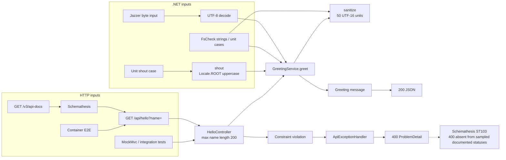

# Fuzzing executive summary

**Snapshot:** 2026-11-10 UTC (2026-11-09 Pacific).
**Tested commit:** `df252e45946c2e86d15783d460e8ed7cacf4fcdf`.
**Assessment:** useful application testing exists; a complete dual-surface
fuzzing system and its evidence-health gates are **not yet implemented**.

This is an evidence-backed design baseline, not a new fuzz campaign.
See the [technical report](fuzzing-evidence-2026-11-10.md) for evidence identifiers,
scope limits, all workflow connections, and artifact sources. The
[system design](../fuzzing-system-design.md) specifies the proposed extension.

**Choose a view:** [Traditional CI/CD pipeline](../fuzzing-pipeline-view.md) or
the original [application connection map](#application-connection-map) below.

## Measured scorecard

| Measure | Observed value | Interpretation |
|---|---|---|
| Workflows | 22 executable definitions: 15 standard, 6 compiled agentic, 1 generated maintenance | Six Markdown authoring files are not six additional executable workflows |
| CI tests | 15 reported tests; 0 failures/errors/skips | Unit, property, Jazzer regression, controller, integration suites |
| Property generation | 2 properties x 1,000 successful checks | 2,000 checks, not 2,000 JUnit methods |
| Application line coverage | 20/22 = 90.91% | Aggregate CI coverlet; not fuzz-only coverage |
| Application branch coverage | 16/18 = 88.89% | Both missed branches are in `GreetingService` |
| .NET mutation controls | 17/17 killed = 100% | Stryker.NET scope excludes fuzz/property/IT test classes |
| Dedicated Jazzer result | 1 regression invocation; 0 failures/errors/skips | Push event executed regression, despite the job's "fuzzing" label |
| Corpus persistence | Cache miss; cache save warned that path did not exist | Sampled result does not establish reusable corpus persistence |
| API contract fuzzing | 1 operation result, 1 failure, 0 errors/skips | Schemathesis ST103: actual 400, OpenAPI documented only 200 |
| DAST normalized records | 10: 2 medium, 2 low, 6 info; 0 blocking | Includes 1 Schemathesis and 9 ZAP records; not 10 confirmed vulnerabilities |
| Commit-scoped push workflows | 8 success, 1 failure out of 9 observed | OpenSSF Scorecard failed; the seven release scanner workflows succeeded |
| Workflow behavioral fuzzing | No campaign identified in the inspected source | Existing actionlint/zizmor/lock-drift checks are not behavioral fuzzing |

## What matters

1. **A passing gate does not mean no findings.** The sampled DAST workflow
   passed because the common gate blocks high/critical findings. Its API
   contract failure was normalized as medium. Rejecting oversized names with
   400 is already intended behavior; the reported mismatch is documentation/
   contract consistency, not evidence that validation should be removed.
2. **Execution labels are not trustworthy measurements.** Main pushes select
   Jazzer regression in the shell branch. The current label calls this
   "fuzzing." The last five fetched Fuzzing runs were all PR/push events; none
   provides measured scheduled coverage-guided fuzzing throughput.
3. **Workflow correctness needs its own lane.** Event ordering, missing reports,
   rerun selection, suppression expiry, and report parsing can affect the final
   verdict even when application tests pass.
4. **Missing evidence must not become an all-clear.** The current normalizer
   warns and continues for missing input paths and several parse failures.
   The proposed manifest makes completeness an independent required decision.

## Application connection map

This diagram describes existing application calls and test coverage paths.

## Recommended system

Keep three independently measured lanes:

- **.NET:** stronger SharpFuzz oracles, direct-string Unicode coverage, FsCheck replay,
  and reviewed regression corpus.
- **HTTP:** schema generation plus explicit 200/201-length boundaries and
  sanitized request/response reproducers.
- **Workflows:** isolated mutation of configuration, events, scanner artifacts,
  gates, and dedupe; no mutated production workflow execution.

All three feed a deterministic evidence validator, minimizer/replayer,
normalizer, and gate. Reports and optional agent narratives consume the same
validated records. See the [architecture and contract](../fuzzing-system-design.md).

## Priority actions

| Priority | Action | Completion evidence |
|---|---|---|
| P0 | Separate evidence health from defect severity | Missing/corrupt/wrong-SHA/zero-test fixtures cannot pass |
| P0 | Correct mode reporting; verify duration and corpus wiring | Cold/warm campaigns report actual mode, effective budget, corpus digest and executions |
| P1 | Document intended 400 response and add boundary replay | The ST103 reproducer passes the intended contract while oversized names remain rejected |
| P1 | Add workflow adapters and control mutations | Every named decision mutant is detected; no real release writes |
| P1 | Publish linked per-run and trend reports | Every metric/diagram edge resolves to source or artifact evidence |
| P2 | Enable new required checks after observation | Seven complete nightly and ten representative PR campaigns reviewed |

No .NET or workflow runtime behavior was changed, no remote workflows were
dispatched, and no newly discovered defect is claimed to have been fixed by this
report. Existing artifacts were downloaded read-only. The .NET SDK was not on the local
PATH; application metrics above come from identified CI artifacts, not a local
rerun.
